# Laporan Praktikum 7: Pemrograman Server-Side dengan PHP

**Mata Kuliah:** Pemrograman Web  
**Dosen Pengampu:** Agung Nugroho, S.Kom., M.Kom.  
**Disusun Oleh:** Nur Muhammad Baha Uddin Naqsabandi (NIM: 312510264)  
**Program Studi:** Teknik Informatika - Universitas Pelita Bangsa  

---
Struktur Direktori
Lab7Web_PHP/
├── cari.php
├── eksperimen.php
├── index.html
├── index.php
├── latihan2.php
├── latihan3.php
├── latihan4.php
├── latihan7.php
├── mini_project.php
├── README.md
└── screenshoot/

---

## 1. Latihan 1: Pengaksesan Web Browser PHP Secara Lokal

Menjalankan skrip PHP pertama kali di atas server web lokal (Laragon/Nginx) untuk menampilkan teks heading serta tanggal dan waktu server secara dinamis menggunakan fungsi `date("d-m-Y H:i:s")`.

* **a. Kondisi Valid (Pengaksesan Localhost Berhasil):**
  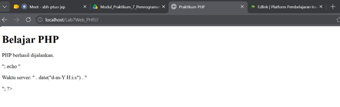
  *Keterangan:* Kode PHP berhasil dieksekusi di sisi server dan menampilkan output HTML beserta *timestamp* waktu server terkini tanpa menampilkan kode mentah PHP.

---

## 2. Latihan 2: Variabel, Operator, dan Percabangan

Mengintegrasikan perhitungan bobot nilai Tugas (30%), UTS (30%), dan UAS (40%) untuk menghitung Nilai Akhir menggunakan operator aritmatika, serta menentukan predikat (`A`, `B`, `C`, `D`) dengan pengkondisian `if-elseif-else`.

* **a. Pengujian Kalkulasi Nilai dan Predikat:**
  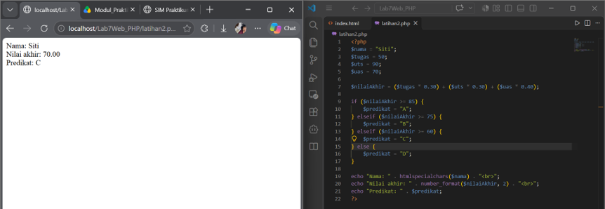
  *Keterangan:* Pengujian dengan nilai Tugas = 50, UTS = 90, dan UAS = 70 menghasilkan Nilai Akhir `70.00` dan secara otomatis mengategorikan predikat ke nilai `C`.

---

## 3. Latihan 3: Perulangan dan Array

Menyimpan sekumpulan data nama mahasiswa dalam variabel bertipe *array* terindeks, kemudian menampilkan seluruh elemen data tersebut ke dalam daftar berurutan `<ol>` menggunakan perulangan `foreach`.

* **a. Tampilan Iterasi Data Array Mahasiswa:**
  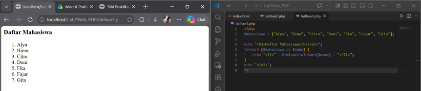
  *Keterangan:* Struktur perulangan `foreach` berhasil mengiterasi seluruh elemen array `[$mahasiswa]` dan menampilkannya secara rapi dalam daftar berurutan 1 sampai 7.

---

## 4. Latihan 4: Membuat Function

Membuat fungsi kustom `hitungDiskon()` untuk menghitung besaran potongan harga berdasarkan persentase, serta membuat fungsi tambahan `cekKelulusan()` untuk mengevaluasi status batas kelulusan nilai.

* **a. Output Hasil Eksekusi Function:**
  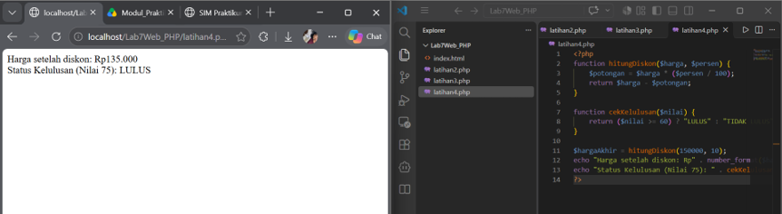
  *Keterangan:* Fungsi `hitungDiskon(150000, 10)` menghasilkan Rp135.000, dan fungsi `cekKelulusan(75)` mengembalikan nilai string status `LULUS`.

---

## 5. Latihan 5: Memproses Form dengan GET

Membuat formulir pencarian sederhana yang menggunakan metode `GET` untuk mengamati bagaimana data dikirimkan melalui URL *query string* serta penanganannya dengan `$_GET`.

* **a. URL Sebelum Form Dikirim:**
  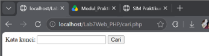
  *Keterangan:* Tampilan awal formulir pencarian di mana URL address bar browser masih mengarah bersih ke `localhost/Lab7Web_PHP/cari.php`.

* **b. Perubahan URL Setelah Form Dikirim:**
  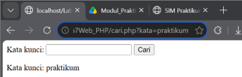
  *Keterangan:* Setelah tombol submit diklik dengan input `praktikum`, URL berubah menjadi `cari.php?kata=praktikum` dan nilainya ditangkap oleh server.

---

## 6. Latihan 6: Memproses Form dengan POST

Membuat formulir pengiriman data pengguna dengan metode `POST` dan menerapkan pengamanan input menggunakan `htmlspecialchars()` untuk mencegah injeksi karakter khusus HTML/script.

* **a. Percobaan Input Karakter Kutip:**
  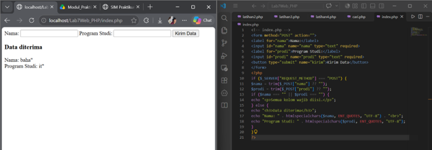
  *Keterangan:* Input nama yang mengandung karakter tanda kutip (`baha"`) berhasil diamankan oleh `htmlspecialchars(..., ENT_QUOTES)` sehingga tidak merusak sintaks HTML.

* **b. Percobaan Input Kosong (Validasi Client-Side):**
  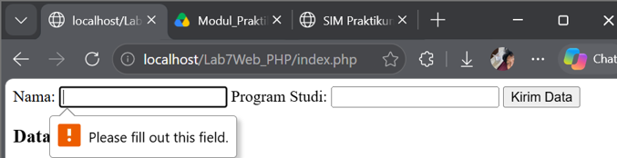
  *Keterangan:* Pengiriman formulir dalam keadaan kosong ditolak secara otomatis oleh browser akibat adanya atribut `required` pada tag input.

* **c. Percobaan Injeksi Tag HTML:**
  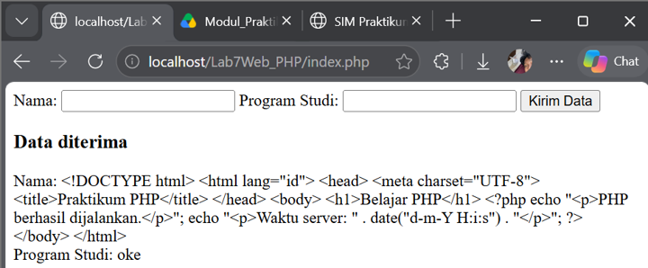
  *Keterangan:* Input berupa tag HTML lengkap `<!DOCTYPE html>...` berhasil diubah menjadi teks mentah (entitas HTML) sehingga aman dari potensi serangan *Cross-Site Scripting* (XSS).

---

## 7. Latihan 7: Pengolahan Data Transaksi Sederhana

Membangun kalkulator transaksi barang yang menerima input nama barang, harga, dan jumlah dengan validasi *server-side* untuk memastikan tipe data angka dan batas kuantitas positif.

* **a. Pengujian Transaksi Data Normal:**
  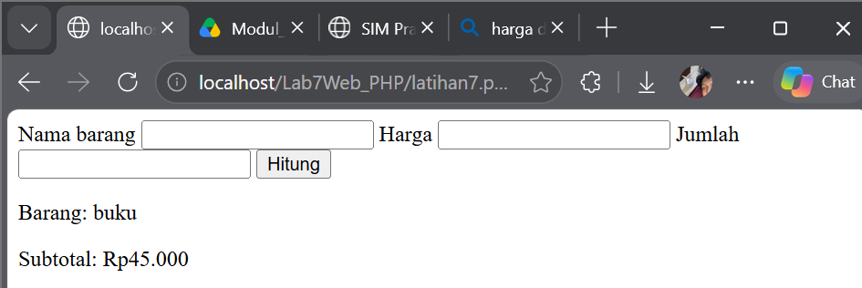
  *Keterangan:* Input data produk "buku" dengan harga dan jumlah normal berhasil diproses dan menghasilkan ringkasan subtotal `Rp45.000`.

* **b. Pengujian Input Harga Desimal:**
  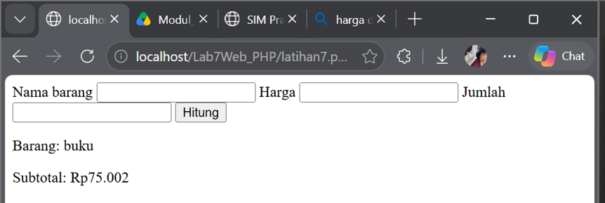
  *Keterangan:* Pengisian harga berbasis desimal diproses secara presisi oleh tipe data `float` PHP dan menghasilkan kalkulasi subtotal `Rp75.002`.

* **c. Pengujian Input Jumlah Negatif / Nol:**
  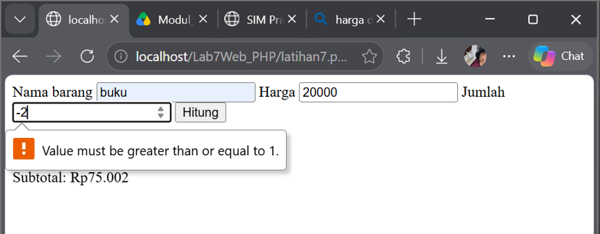
  *Keterangan:* Pengisian jumlah barang bernilai negatif (`-2`) ditolak oleh aturan validasi input `min="1"` pada elemen HTML5.

---

## 8. Mini Project: Aplikasi Formulir Data Mahasiswa

Membuat aplikasi formulir penginputan data mahasiswa lengkap (Nama, NIM, Program Studi, Semester, dan Email) yang memisahkan logika validasi *server-side* dengan tampilan interface HTML.

* **a. Kondisi Valid (Data Berhasil Diterima):**
  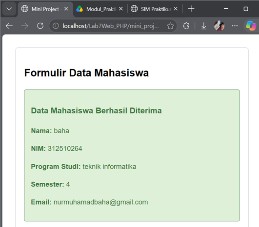
  *Keterangan:* Seluruh field diisi dengan benar (Nama: baha, NIM: 312510264, Prodi: teknik informatika, Semester: 4, Email: nurmuhamadbaha@gmail.com) dan berhasil menampilkan ringkasan data berlatar hijau.

* **b. Kondisi Tidak Valid (Error Validasi Email):**
  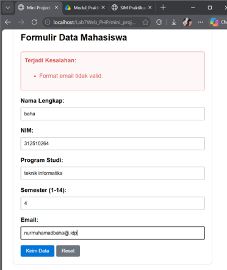
  *Keterangan:* Penginputan email yang tidak valid (`nurmuhamadbaha@.idp`) langsung tertangkap oleh `filter_var(..., FILTER_VALIDATE_EMAIL)` dan menampilkan pesan peringatan error "Format email tidak valid."

---

## 9. Eksperimen Mandiri (Point G)

### 1. Perhitungan Nilai Rata-Rata Tiga Komponen
* **a. Hasil Kalkulasi Rata-Rata Nilai:**
  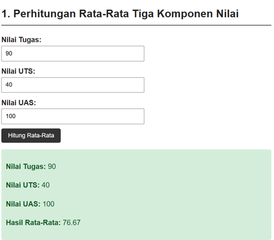
  *Keterangan:* Penginputan nilai Tugas (90), UTS (40), dan UAS (100) diproses oleh skrip PHP dan menghasilkan kalkulasi nilai rata-rata `76.67`.

### 2. Pencarian Nama Mahasiswa dari Array (Metode GET)
* **a. Hasil Filter Nama Array:**
  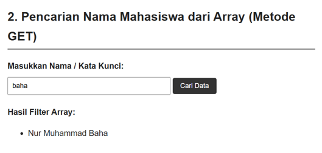
  *Keterangan:* Memasukkan kata kunci `baha` melalui metode `GET` berhasil menyaring daftar *array* dan menampilkan nama `Nur Muhammad Baha`.

### 3. Function Format Harga Menjadi Rupiah
* **a. Output Konversi Currency Rupiah:**
  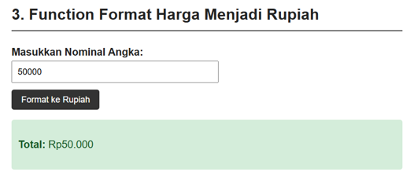
  *Keterangan:* Penginputan nominal angka `50000` berhasil dikonversi secara otomatis oleh fungsi `formatRupiah()` menjadi format mata uang `Total: Rp50.000`.

### 4. Validasi NIM Server-Side (9 Digit Angka)
* **a. Pengujian NIM Valid:**
  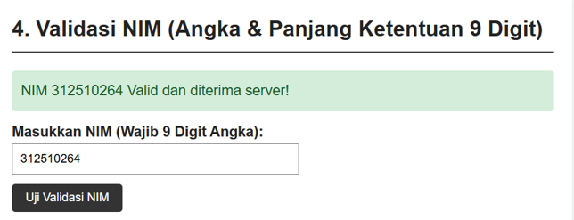
  *Keterangan:* Pengisian NIM `312510264` lolos pengujian `ctype_digit` dan pemeriksaan batas panjang 9 digit sehingga diterima oleh server.

### 5. Tombol Reset Form & Penjelasan Server-Side
* **a. Pengujian Tombol Reset Client-Side:**
  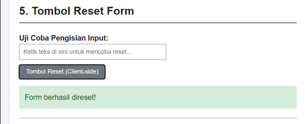
  *Keterangan:* Mengeklik tombol `Reset` di sisi *client-side* mengosongkan bidang input secara instan tanpa melakukan *request* ulang ke web server.

---

## 10. Pertanyaan Evaluasi & Jawaban (Point H)

1. **Apa perbedaan pemrosesan client-side dan server-side?**  
   Client-side: Proses yang dijalankan di sisi browser pengguna menggunakan bahasa seperti HTML, CSS, dan JavaScript untuk menangani tampilan visual serta interaksi lokal tanpa perlu menghubungi server. Server-side: Proses yang dijalankan di server menggunakan bahasa seperti PHP untuk mengolah logika aplikasi, memproses input data pengguna, menjalankan aturan aplikasi, dan mengirimkan respons kembali ke browser berupa output HTML.

2. **Mengapa file PHP harus dijalankan melalui web server?**  
   File PHP diproses di sisi server dan membutuhkan web server (seperti Apache atau Nginx yang mendukung PHP) untuk mengeksekusi skrip di dalamnya. Browser tidak memiliki *interpreter* PHP bawaan, sehingga jika file PHP dibuka secara langsung tanpa melalui web server (misalnya klik ganda), browser hanya akan menampilkan kode PHP mentah sebagai teks biasa.

3. **Apa fungsi tanda $ pada variabel PHP?**  
   Tanda $ digunakan sebagai penanda awal atau predikat wajib dalam mendeklarasikan sekaligus memanggil nama variabel pada PHP. Semua nama variabel dalam PHP harus diawali tanda $ dan bersifat *case-sensitive* (membedakan huruf besar dan huruf kecil).

4. **Apa perbedaan metode GET dan POST?**  
   GET: Mengirimkan data dengan menempelkannya langsung pada parameter URL dan sesuai untuk permintaan yang tidak mengubah data (seperti pencarian). Metode ini terbatas pada panjang URL dan kurang aman untuk data sensitif. POST: Mengirimkan data di dalam *body HTTP request* dan lazim digunakan untuk pengiriman formulir, transaksi data, atau informasi sensitif karena tidak menampilkan data pada baris alamat URL.

5. **Mengapa input pengguna perlu divalidasi di sisi server?**  
   Validasi di sisi *client* (seperti atribut `required` HTML atau pengecekan JavaScript) berada di kontrol browser pengguna sehingga sangat mudah dimanipulasi, dilewati, atau dimatikan melalui *developer tools*. Oleh karena itu, validasi di sisi *server* (*server-side validation*) tetap wajib dilakukan sebagai pemeriksaan utama untuk menjamin integritas dan keamanan data aplikasi.

6. **Apa fungsi htmlspecialchars() ketika menampilkan data dari form?**  
   Fungsi `htmlspecialchars()` digunakan ketika menampilkan kembali input pengguna ke halaman HTML untuk mengonversi karakter khusus HTML (seperti `<`, `>`, `&`, `"`) menjadi entitas karakter yang aman. Langkah ini berfungsi mencegah browser mengeksekusi skrip liar sehingga mengurangi risiko injeksi HTML atau serangan *Cross-Site Scripting* (XSS).

7. **Apa manfaat penggunaan function dalam program PHP?**  
   Reusabilitas: Memungkinkan kumpulan kode program dipanggil berulang kali di berbagai tempat tanpa perlu menulis ulang kodenya. Modularitas: Memecah alur program yang kompleks menjadi bagian-bagian yang terstruktur, rapi, dan lebih mudah dipahami. Kemudahan Pemeliharaan: Memudahkan pemeliharaan dan perbaikan kesalahan (*bug*), karena perubahan logika cukup dilakukan pada satu lokasi *function* tersebut.
